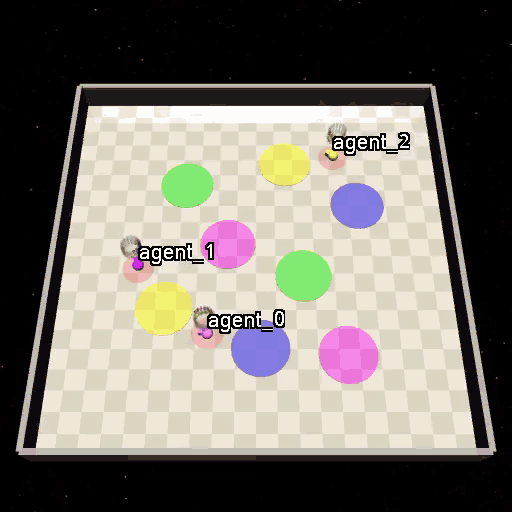
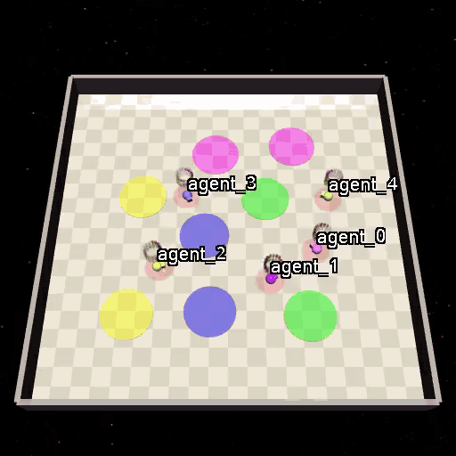
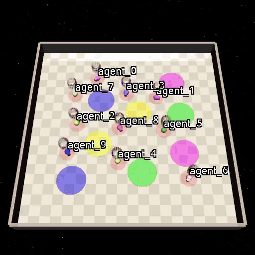
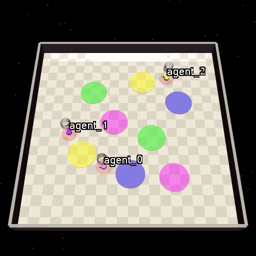

<h1 align="center">
<br>
<!-- TODO: paper title -->
SpecMAGIC: [Paper Title Placeholder]
</h1>

<p align="center">
Repo for "<a href="TODO" target="_blank">SpecMAGIC</a>" <!-- TODO: link + venue -->
</p>

## Method

We propose a hierarchical framework consisting of a centralized high-level planner and decentralized low-level policies. The high-level planner directly operates in the subtask space to construct a feasible subtask sequence that satisfies the given specifications, while the low-level policies sequentially execute the planned subtasks.

<!-- TODO: optional framework figure -->
<!-- <p align="center"></p> -->

## Installation

The code is adapted from [GenZ-LTL](https://www.arxiv.org/abs/2508.01561) and [SpecRLBench](https://arxiv.org/abs/2604.24729) and requires Python 3.10 and PyTorch (tested with version 2.2.2). To use the _Zone_ environment, use the following command to install the required dependencies:
```bash
conda activate spec-marl
cd src/envs/zones/safety-gymnasium
pip install -e .
```
To install the remaining dependencies, run
```bash
pip install -r requirements.txt
```
We use [_spot_](https://spot.lre.epita.fr/) to convert LTL formulae into automata.

### Number of agents

The number of agents is selected by the environment ID:

| Environment ID | Agents |
| --- | --- |
| `SafetyPointMultiGoal0-v0.ma3` | 3 |
| `SafetyPointMultiGoal0-v0.ma5` | 5 |
| `SafetyPointMultiGoal0-v0.ma10` | 10 |

These are registered in `src/envs/zones/safety-gymnasium/safety_gymnasium/__init__.py` (`multi_goal_tasks`). Make sure the specification matches the number of agents. The atomic propositions are `blue_i`, `green_i`, `magenta_i`, `yellow_i` for `i` in `0, ..., n-1`.

All variants share the experiment folder `experiments/rco/SafetyPointMultiGoal0-v0/`, so include the number of agents in the experiment name (e.g. `--name specmagic_ma3`).

## Training

To launch training on the _Zone_ environment, run
```bash
PYTHONPATH=src/ python run_zones_safety.py --script train_rco --device gpu --env SafetyPointMultiGoal0-v0.ma3 --name <model_name> --seed <seed>
```
All experiment logs and model checkpoints will be stored in the `experiments` directory.

## Evaluation

Each specification consists of one LTL formula per agent (`agent_i`), a requirement specification (`req`) and a counting specification (`cnt`). The test specifications are defined in `src/evaluation/eval_test_tasks_finite.py` and `src/evaluation/eval_test_tasks_infinite.py`, grouped by `--key` (e.g. `ma3_ind_req_cnt`, `ma5_ind_req_cnt`, `ma10_ind_req_cnt`).

To evaluate a trained model across multiple specifications, run:
```bash
# finite-horizon tasks
PYTHONPATH=src/ python src/evaluation/eval_test_tasks_finite.py --env <env_name> --exp <model_name> --seed <seed> --key <task_key>

# infinite-horizon tasks
PYTHONPATH=src/ python src/evaluation/eval_test_tasks_infinite.py --env <env_name> --exp <model_name> --seed <seed> --key <task_key>
```
The results will be stored in the `results_finite` and `results_infinite` directories, respectively.

To visualize the trajectories for a single specification, set `formula` in `src/evaluation/draw_zone_trajectories.py` and run:
```bash
python src/evaluation/draw_zone_trajectories.py
```

## Visualizations

We present visualizations of SpecMAGIC in the Zone environment with 3, 5 and 10 agents on finite-horizon specifications, and with 3 agents on an infinite-horizon specification.

<table align="center" style="width:100%; border-collapse: collapse; border: none;">
  <tr>
    <td align="center" valign="top" width="50%" style="border: none;">
      <br>
      <b>3 agents, finite-horizon</b>
    </td>
    <td align="center" valign="top" width="50%" style="border: none;">
      <br>
      <b>5 agents, finite-horizon</b>
    </td>
  </tr>
  <tr>
    <td align="center" valign="top" width="50%" style="border: none;">
      <br>
      <b>10 agents, finite-horizon</b>
    </td>
    <td align="center" valign="top" width="50%" style="border: none;">
      <br>
      <b>3 agents, infinite-horizon</b>
    </td>
  </tr>
</table>

The specifications used in the visualizations are listed below. <!-- TODO: update if you render different specs -->

<details>
<summary><b>3 agents, finite-horizon</b> (<code>ma3_ind_req_cnt</code>)</summary>

```python
{
    "agent_0": '(!magenta_0 U (blue_0 | green_0)) & (F magenta_0)',
    "agent_1": '(F blue_1) & (!blue_1 U (green_1 & F yellow_1))',
    "agent_2": '!(magenta_2 | yellow_2) U (blue_2 & F green_2)',
    "req": "(blue_0 Req green_1) & (blue_1 Req green_2) & (blue_2 Req magenta_0)",
    "cnt": "Sync[{0, 2}, yellow, 2] & Async[{0, 1, 2}, green, 3]",
}
```
</details>

<details>
<summary><b>5 agents, finite-horizon</b> (<code>ma5_ind_req_cnt</code>)</summary>

```python
{
    "agent_0": '(!magenta_0 U (blue_0 | green_0)) & (F magenta_0)',
    "agent_1": '(F blue_1) & (!blue_1 U (green_1 & F yellow_1))',
    "agent_2": '!(magenta_2 | yellow_2) U (blue_2 & F green_2)',
    "agent_3": '!magenta_3 U ((blue_3 | yellow_3) & F green_3)',
    "agent_4": '!(blue_4 | yellow_4) U (green_4 & F magenta_4)',
    "req": "(blue_0 Req green_1) & (blue_1 Req green_2) & (green_2 Req yellow_3) & (green_3 Req green_4)",
    "cnt": "Async[{0, 1, 2, 3, 4}, yellow, 3] & Sync[{0, 1, 2, 3, 4}, blue, 2]",
}
```
</details>

<details>
<summary><b>10 agents, finite-horizon</b> (<code>ma10_ind_req_cnt</code>)</summary>

```python
{
    "agent_0": '!(magenta_0 | yellow_0) U (blue_0 & F green_0)',
    "agent_1": '!magenta_1 U ((green_1 | blue_1) & F yellow_1)',
    "agent_2": '(!magenta_2 U (blue_2 | green_2)) & (F magenta_2)',
    "agent_3": '(F magenta_3) & (!yellow_3 U (blue_3 | green_3))',
    "agent_4": '!magenta_4 U ((blue_4 | yellow_4) & F green_4)',
    "agent_5": '!(green_5 | yellow_5) U (magenta_5 & F blue_5)',
    "agent_6": '(F blue_6) & (!blue_6 U (green_6 & F yellow_6))',
    "agent_7": '!(blue_7 | yellow_7) U (green_7 & F magenta_7)',
    "agent_8": '!green_8 U (yellow_8 & F (blue_8 | magenta_8))',
    "agent_9": '!(magenta_9 | yellow_9) U (blue_9 & F green_9)',
    "req": "(blue_0 Req green_1) & (blue_1 Req green_2) & (blue_2 Req magenta_3) & (blue_3 Req blue_4) & "
           "(green_4 Req magenta_5) & (blue_5 Req green_6) & (blue_6 Req green_7) & (magenta_7 Req blue_8) & (yellow_8 Req blue_9)",
    "cnt": "Async[{0, 1, 2, 3, 4, 5, 6, 7, 8, 9}, blue, 9]",
}
```
</details>

<details>
<summary><b>3 agents, infinite-horizon</b> (<code>ma3_ind_req_cnt</code>)</summary>

```python
{
    "agent_0": '(GF blue_0) & (GF green_0) & (G !yellow_0)',
    "agent_1": '(GF yellow_1) & (GF green_1) & (G !blue_1)',
    "agent_2": '(GF magenta_2) & (GF blue_2) & (G !green_2)',
    "req": "(blue_0 EachReq green_1) & (yellow_1 EachReq blue_2)",
    "cnt": "!Async[{0, 1, 2}, magenta, 2]",
}
```
</details>

## Bibtex

If you find our work useful, please cite it as:
```
@inproceedings{TODO,
  title={TODO},
  author={TODO},
  booktitle={TODO},
  year={TODO}
}
```
